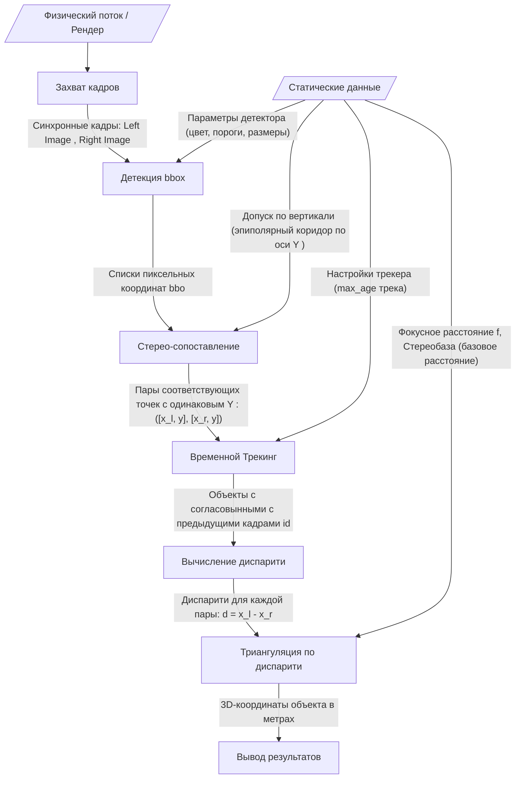

**Этапы алгоритма компютерного зрения**
|№ |Этап процесса |Входные данные (динамика)| Статические данные (конфиг)| Выходные данные|
|-|:---------------|:-------------------|:-------------------------|:----------|
|**1**| Захват кадров| Физический поток / Рендер |—| Синхронные кадры: Left Image , Right Image|
|**2**| Детекция bbox| Кадры: Left Image , Right Image| Параметры детектора (цвет, пороги, размеры)| Списки пиксельных координат bbox|
|**3**| Стерео-сопоставление| Координаты центроидов bbox левого и правого кадров| Допуск по вертикали (эпиполярный коридор по оси Y )| Пары соответствующих точек с одинаковым Y : ([x_l, y], [x_r, y])|
|**4**| Временной Трекинг| bbox и пары с одинаковым Y : ([x_l, y], [x_r, y])| Настройки трекера ( max_age трека)| Объeкты с согласовынными с предыдущими кадрами id|
|**5**| Вычисление диспарити| Пары сопоставленных точек| —| Диспарити для каждой пары: d = x_l - x_r|
|**6**| Триангуляция по диспарити| Оттреканные текущие x, y и d| • Фокусное расстояние f • Стереобаза (базовое расстояние) |3D-координаты объекта в метрах|
|**7**| Вывод результатов| Координаты [X, Y, Z] и ID объекта| —| Передача в UI / Запись в лог / Финальный хендлер|

